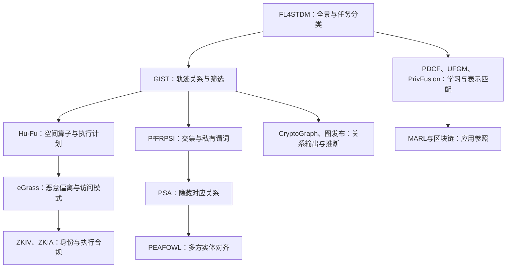

# 阅读地图与机制总结

## 建议路线

箭头是学习依赖建议，不表示引用关系，也不意味着安全协议可以直接组合。

## 分层学习

1. FL4STDM、GIST、Hu-Fu：区分共同训练预测模型与执行精确查询，理解安全算子如何嵌入执行计划。
2. P²FRPSI、PSA、PEAFOWL：区分交集输出、私有条件选择、隐藏对应关系和多方对齐。
3. eGrass：理解恶意偏离、安全中止、诚实多数与访问模式。
4. Crypto’Graph和图发布论文：区分私有计算中间过程与最终输出可能带来的推断。
5. UFGM、PrivFusion、PDCF：辨认节点匹配、模型神经元匹配和推荐学习的任务差别。
6. ZKIV、ZKIA、MARL+区块链：分别作为身份、执行合规和应用组合的参照。

## 逐篇机制卡

| 文献 | 核心问题与机制 | 阅读时应保留的边界 |
|---|---|---|
| FL4STDM | 时空联邦学习综述，涉及基本、图、聚类和去中心化STFL | 数据不出域不自动等于密码学隐私保证；综述挑战不等于未研究空白 |
| GIST | 扰动网格筛选后安全验证轨迹关系 | 查询采样时刻与候选插值位置的阈值关系不是全程连续同行；已讨论多数据方 |
| Hu-Fu | 空间查询分解与专用安全算子 | 明文/密态分工须说明各步骤的可见信息 |
| PDCF | 上下文联邦在线推荐、项目簇树与差分隐私 | 推荐效用和遗憾界不等于精确查询正确性 |
| ZKIV | 身份属性声明与零知识证明 | 属性验证不保证设备观测真实或数据库完整 |
| MARL+Blockchain | 金融欺诈检测与许可链审计组合 | 分类质量、审计记录和安全协议分别评价；本文未复现 |
| ZKIA | 意图拍卖合规证明与异步乐观排序验证 | 拍卖激励假设和轨迹任务不同；开发网及估计开销不等于生产部署 |
| eGrass | 加密属性子图匹配，秘密分享等机制支撑恶意安全 | 三服务器、非串通、诚实多数、至多一台恶意；安全中止不等于保证得到结果 |
| 图发布PPGSL | 学习可发布图以抵御敏感边推断，并权衡效用 | 发布后抗推断与在线SMC保密是不同目标 |
| PEAFOWL | 隐藏排列与秘密分享洗牌支持多方PPML实体对齐 | 半诚实；服务器不与数据方串谋；交集基数仍属泄露 |
| P²FRPSI | S³R及DH/OT构造，使客户端获得满足私有谓词的交集 | 半诚实模型；ID相等不是任意几何匹配 |
| PSA | OPRF与改造OSN，隐蔽对齐供后续分析 | 隐私级别、半诚实/非串通前提及预处理成本应分别看 |
| UFGM | Graphlet近似采样生成伪匹配，分离信赖域优化 | 学习推断不是精确实体证明；矩阵变换不能直接视作通用MPC安全 |
| PrivFusion | 将模型表示为图进行匹配融合，以LDP保护激活和权重 | 匹配对象是模型结构；预算组合和效用损失需核对 |
| Crypto’Graph | 相同节点集、不同边的分布式图上进行私有链路预测 | 节点已经对应；关系分数不是真实关系；重复输出可能带来推断 |

## 原文证据位置

以上为定向总结。共同入口为各文PDF首页摘要；GIST另核p2–3/p9，eGrass核p2/p4，PEAFOWL核p2/p4，PSA核p6，P²FRPSI核p2，UFGM核p2–4，PrivFusion核p2/p8，Crypto’Graph核p4/p7。PDF版本变化可能改变物理页码，不据此声称已完成全文证明审计。官方来源见[目录](README.md)与[papers.json](papers.json)。

## 每篇的阅读记录模板

- 输入、输出和结果接收方是什么？
- 谁持有什么数据，谁可能串谋？
- 公开集合大小、交集基数、访问模式或结果身份吗？
- 核心机制解决了什么，依赖什么假设？
- 实验基线是否具有相同功能、威胁和泄露条件？
- 哪些主张有原文证据，哪些仍待复现或审计？

不要直接比较不同论文摘要中的倍数或耗时；精确查询、近似学习、身份验证和数据发布的指标不相同。
